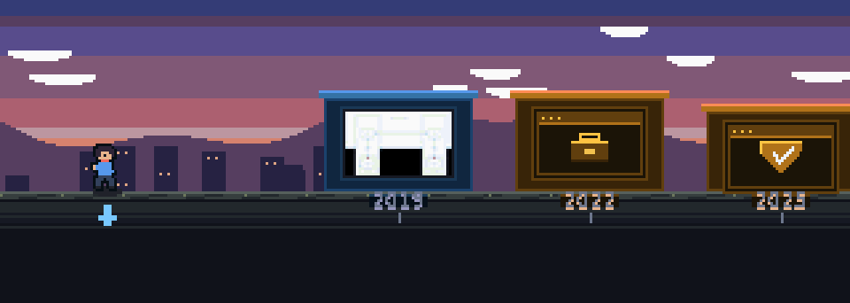

### Hi, I'm GoodyHao 👋

  

  Contribution calendar animation by <a href="https://github.com/ststyin/contriboom">contriboom</a>, refreshed daily by GitHub Actions.

---

  

  <b>Pixel Walk</b> · 2019 → 2026，14 个项目排成一条街。房高 = star 数，房色 = 主语言，天色从破晓走到入夜。 
  数据取自 GitHub API，画面由代码逐像素绘制。

